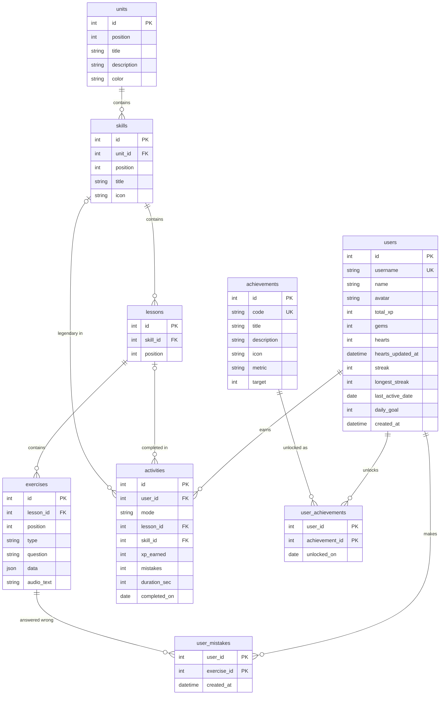

# Duolingo Clone

A full-stack clone of the Duolingo web app: a learning path of units and skills, a lesson player with five
interactive exercise types, and Duolingo's gamification loop: **XP, streaks, hearts, gems, a weekly league
and achievements**. One Spanish course is seeded so the app is usable immediately.

> Built as an SDE full-stack assignment. Educational project, not affiliated with Duolingo.
> The mascot ("Pip"), sounds and icons are original; no Duolingo assets are used.

- **Live demo:** _add your Vercel URL here_

---

## Contents

1. [Features](#features)
2. [Tech stack](#tech-stack)
3. [Getting started](#getting-started)
4. [Project structure](#project-structure)
5. [Architecture](#architecture)
6. [Database schema](#database-schema)
7. [API overview](#api-overview)
8. [Game rules](#game-rules)
9. [Deployment](#deployment)
10. [Assumptions & limitations](#assumptions--limitations)

---

## Features

### Core (required)

| Area              | What's implemented                                                                                                                                                                                                                                              |
| ----------------- | --------------------------------------------------------------------------------------------------------------------------------------------------------------------------------------------------------------------------------------------------------------- |
| **Learning path** | 3 units × 3 skills on a zig-zag path; locked / active / completed states; progress ring on the active skill, crown badges on completed ones, gold nodes for Legendary; sticky unit banners; START bubble; tap a node for its lesson card                        |
| **Lesson player** | 5 exercise types: **multiple choice** (picture cards), **translate** (word bank), **match pairs**, **fill in the blank**, **type the answer**; green/red feedback bar with the correct solution; progress bar; wrong answers come back at the end of the lesson |
| **Hearts**        | Lose one per wrong answer; "out of hearts" modal; hearts regenerate over time (1 per 30 min); refill with gems; earn one back through practice                                                                                                                  |
| **XP & streak**   | 10 XP per lesson (+5 for a perfect lesson); streak grows once per day, resets after a missed day; streak screen after the first lesson of the day                                                                                                               |
| **Daily goal**    | 10 / 20 / 30 / 50 XP per day, progress card on the right panel                                                                                                                                                                                                  |
| **Leaderboard**   | Weekly Bronze League across 11 learners with promotion / demotion zones                                                                                                                                                                                         |
| **Profile**       | Stats, weekly XP chart, streak calendar, 8 achievements with progress                                                                                                                                                                                           |
| **Persistence**   | All progress is stored per user in SQLite                                                                                                                                                                                                                       |
| **Duolingo UX**   | 3D buttons, celebratory screens with confetti, modals, toasts, mascot moods, responsive menus, placeholders ("Coming soon") for mocked features                                                                                                                 |

### Bonus (all six from the brief, plus extras)

| Bonus               | How                                                                                                                                                                        |
| ------------------- | -------------------------------------------------------------------------------------------------------------------------------------------------------------------------- |
| 🔊 Audio            | Browser text-to-speech reads Spanish words and sentences (no audio files)                                                                                                  |
| 🏆 Achievements     | 8 badges, stored in the database, toast when unlocked                                                                                                                      |
| 📊 Real leaderboard | Ranked live from everyone's XP this week                                                                                                                                   |
| ⏱️ Legendary mode   | Timed challenge (2 min, 3 lives) on completed skills; the node turns gold                                                                                                  |
| 🌙 Dark mode        | Toggle in Settings, remembered per browser, no flash on reload                                                                                                             |
| 📱 Responsive       | Phone (bottom tab bar), tablet (icon sidebar), laptop, wide desktop (right panel)                                                                                          |
| Extras              | Practice-your-mistakes mode, combo counter ("🔥 5 in a row"), generated sound effects, keyboard shortcuts (`1-4`, `Enter`, `Esc`), "simulate next day" for testing streaks |

---

## Tech stack

| Layer    | Technology                                                                             |
| -------- | -------------------------------------------------------------------------------------- |
| Frontend | **Next.js 16** (App Router, TypeScript, React 19), **Tailwind CSS 4**, canvas-confetti |
| Backend  | **Python + FastAPI**, SQLAlchemy 2, Pydantic 2, Uvicorn                                |
| Database | **SQLite** (schema designed from scratch)                                              |
| Tests    | pytest (game rules + API flow)                                                         |
| Hosting  | Vercel (frontend), Render (backend)                                                    |

---

## Getting started

**Requirements:** Python 3.12+ and Node.js 20+.

### 1. Backend (http://localhost:8000)

```bash
cd backend
python -m venv .venv
# Windows: .venv\Scripts\activate      macOS/Linux: source .venv/bin/activate
pip install -r requirements.txt
uvicorn app.main:app --reload
```

The database file `backend/duolingo.db` is created and **seeded automatically** on first start.
Interactive API docs: http://localhost:8000/docs

### 2. Frontend (http://localhost:3000)

```bash
cd frontend
npm install
npm run dev
```

The frontend forwards every `/api/...` request to the backend (set in `next.config.ts`), so no extra
configuration is needed locally.

### 3. Tests

```bash
cd backend
pytest -v          # 22 tests: streak, hearts, answer checking, full lesson flow
```

### Useful demo controls (Settings page)

- **Simulate next day**: moves every stored date back one day, to test streak logic live.
- **Reset demo data**: wipes the database and seeds it again (also: `python -m app.seed`).

---

## Project structure

```
duolingo-clone/
├── backend/
│   ├── app/
│   │   ├── main.py          # FastAPI app, CORS, routers, seed on startup
│   │   ├── database.py      # SQLite engine + session per request
│   │   ├── models.py        # the 9 database tables
│   │   ├── schemas.py       # request / response shapes (Pydantic)
│   │   ├── game_logic.py    # pure rules: hearts, streak, XP, answer checking
│   │   ├── services.py      # shared DB helpers (path, stats, finishing a lesson)
│   │   ├── seed.py          # Spanish course, sample learner, rivals, badges
│   │   └── routes/          # user.py · learn.py · practice.py
│   ├── tests/               # test_game_logic.py · test_api.py
│   └── requirements.txt
├── frontend/
│   ├── app/                 # pages (App Router)
│   │   ├── (main)/          # pages with menus: learn, practice, leaderboard, shop, profile, settings
│   │   ├── lesson/[lessonId]/   legendary/[skillId]/   review/   (full-screen sessions)
│   │   ├── layout.tsx       # root layout: font, theme, providers
│   │   └── globals.css      # design tokens (colours, dark mode, animations)
│   ├── components/
│   │   ├── ui/              # Button, Card, Modal, Toast, ProgressBar, Mascot, Countdown ...
│   │   ├── layout/          # Sidebar, MobileNav, TopBar, StatsBar, RightPanel
│   │   ├── path/            # UnitHeader, SkillNode
│   │   ├── exercises/       # the 5 exercise types + ExerciseView
│   │   ├── lesson/          # LessonScreen, LessonPlayer, FeedbackBar, end screens ...
│   │   └── profile/         # XpChart, StreakCalendar, AchievementBadge
│   └── lib/                 # api.ts, types.ts, lesson-state.ts, user-context, sounds, speech ...
├── docs/CODE_WALKTHROUGH.md # every file explained
└── render.yaml              # backend deployment blueprint
```

---

## Architecture

```
┌──────────── Browser (Next.js) ─────────────┐          ┌────────────── FastAPI ───────────────┐
│ pages (app/)  →  components  →  lib/api.ts │  /api/*  │ routes/*.py      thin HTTP layer      │
│ lib/user-context  (shared learner stats)   │ ───────► │   ↓                                   │
│ lib/lesson-state  (lesson state machine)   │  JSON    │ services.py      DB queries + combine │
└────────────────────────────────────────────┘          │ game_logic.py    pure rules (tested)  │
   next.config.ts rewrites /api/* to the backend        │   ↓                                   │
   (same origin for the browser → no CORS issues)       │ models.py → SQLite                    │
                                                        └───────────────────────────────────────┘
```

**Key design decisions**

1. **The server grades answers.** The browser never receives answers (they are removed by
   `hide_answers()`); each answer is sent to `POST /api/exercises/{id}/check`. Grading ignores case,
   accents and punctuation and accepts several correct answers.
2. **Time-based rules without background jobs.** Hearts store _when_ they last changed and regrow when
   the user is read; the streak stores the last active date and is evaluated on read. No cron needed.
3. **One history table.** Every finished session is a row in `activities`. Lesson progress, today's XP,
   the weekly leaderboard, the streak calendar and achievement stats are all calculated from it, so no
   number is stored twice.
4. **Locked/unlocked is derived, not stored.** A skill is completed when all its lessons are in
   `activities`; the first unfinished skill is active; the rest are locked.
5. **Rules are pure functions.** `game_logic.py` has no database code, so it is unit-tested directly.
   On the frontend, `lesson-state.ts` is a reducer (pure state machine) for the same reason.
6. **Auth is a single seam.** `get_current_user()` returns the seeded learner; real login would only
   replace that function.

---

## Database schema



| Table                                  | Purpose                                                                                                                                        |
| -------------------------------------- | ---------------------------------------------------------------------------------------------------------------------------------------------- |
| `units → skills → lessons → exercises` | Course content, ordered by `position`, deleted together (`ON DELETE CASCADE`)                                                                  |
| `exercises.data` (JSON)                | Fields that differ per exercise type, e.g. `{"sentence", "words", "answers"}` for translate. One JSON column instead of five near-empty tables |
| `users`                                | Learner stats: XP, gems, hearts + `hearts_updated_at`, streak + `last_active_date`, daily goal                                                 |
| `activities`                           | One row per finished lesson / practice / legendary run: the learner's history (`mode` says which). Index on `(user_id, completed_on)`          |
| `user_mistakes`                        | Exercises answered wrongly, for "Practice your mistakes". Composite primary key stops duplicates                                               |
| `achievements` / `user_achievements`   | Badge definitions (`metric` + `target`) and who unlocked what, when                                                                            |

SQLite foreign keys are switched on for every connection (`PRAGMA foreign_keys=ON`).

---

## API overview

All endpoints are under `/api` and documented interactively at `/docs`.

| Method | Endpoint                          | Description                                                                                   |
| ------ | --------------------------------- | --------------------------------------------------------------------------------------------- |
| GET    | `/me`                             | Top-bar stats: streak, XP, gems, hearts (+ seconds to next heart), today's XP                 |
| PATCH  | `/me/settings`                    | Update name and/or daily goal (10, 20, 30, 50)                                                |
| POST   | `/hearts/refill`                  | Spend 350 gems for full hearts                                                                |
| GET    | `/leaderboard`                    | Everyone ranked by XP earned this week                                                        |
| GET    | `/profile`                        | Stats, achievements with progress, active dates, XP for the last 7 days                       |
| GET    | `/path`                           | Units → skills with `state`, progress, next lesson, legendary flag                            |
| GET    | `/lessons/{id}`                   | A lesson's exercises **without answers** (403 if locked or out of hearts)                     |
| POST   | `/exercises/{id}/check`           | Grade one answer → `{correct, correct_answer, hearts}`; wrong answers cost a heart in lessons |
| POST   | `/lessons/{id}/complete`          | Save the result: XP, streak, new achievements                                                 |
| GET    | `/practice/mistakes`              | Practice session from recent mistakes                                                         |
| POST   | `/practice/complete`              | +1 heart and XP                                                                               |
| GET    | `/skills/{id}/legendary`          | Timed challenge for a completed skill                                                         |
| POST   | `/skills/{id}/legendary/complete` | Mark the skill legendary (+40 XP)                                                             |
| POST   | `/dev/next-day`                   | Demo tool: pretend one day has passed                                                         |
| POST   | `/dev/reset`                      | Demo tool: wipe and re-seed                                                                   |

---

## Game rules

All numbers live at the top of `backend/app/game_logic.py`.

| Rule         | Value                                                                |
| ------------ | -------------------------------------------------------------------- |
| Max hearts   | 5, one grows back every **30 minutes**                               |
| Wrong answer | −1 heart in lessons; free in practice; legendary has its own 3 lives |
| Refill       | 350 gems                                                             |
| XP           | lesson 10 (+5 if no mistakes), practice 10, legendary 40             |
| Streak       | first XP of a day: +1 if active yesterday, otherwise reset to 1      |
| Shown streak | 0 as soon as a whole day is missed                                   |

---

## Deployment

### Backend on Render

1. Push the repository to GitHub.
2. On render.com: **New → Blueprint** → select the repository (uses `render.yaml`), or create a Web
   Service with root directory `backend`, build `pip install -r requirements.txt`, start
   `uvicorn app.main:app --host 0.0.0.0 --port $PORT`.
3. Set `CORS_ORIGINS` to your Vercel URL.

### Frontend on Vercel

1. **Add New → Project** → import the repository, set **Root Directory** to `frontend`.
2. Add the environment variable `BACKEND_URL` = your Render URL (e.g. `https://duolingo-clone-api.onrender.com`), not the Vercel frontend URL. This is required for production builds.
3. Deploy. Requests to `/api/*` are forwarded to the backend.

### Environment variables

| Variable           | Where    | Default                           |
| ------------------ | -------- | --------------------------------- |
| `BACKEND_URL`      | frontend | `http://localhost:8000` in development; required in production |
| `DATABASE_URL`     | backend  | SQLite file `backend/duolingo.db` |
| `CORS_ORIGINS`     | backend  | `http://localhost:3000`           |
| `ENABLE_DEV_TOOLS` | backend  | `true`                            |

---

## Assumptions & limitations

- **Single default learner.** Authentication is simplified (allowed by the brief): every request acts as
  the seeded learner "Alex". Ten other seeded learners populate the leaderboard.
- **One course.** Spanish for English speakers: 3 units, 9 skills, 18 lessons, 108 exercises, generated
  from word and sentence lists in `seed.py`.
- **Dates use the server's clock.** The "day" for streaks and the daily goal follows the server's
  timezone; there is no per-user timezone.
- **Free hosting resets data.** Render's free plan does not keep files between restarts, so SQLite is
  re-created and re-seeded when the service restarts. Progress persists while it is running. A paid
  persistent disk (or Railway volume) keeps it permanently.
- **Gems are play money**: no payments. Super Duolingo, Streak Freeze, friends, guidebooks and
  account settings are "Coming soon" placeholders.
- **Audio** uses the browser's built-in voices, so pronunciation quality depends on the device.
  Sound effects are generated with the Web Audio API.
- **Answers are checked on the server**, except match pairs, which needs instant feedback per tap; the
  server still verifies the final pairs.
- **AI assistance** was used during development, as permitted by the brief.
